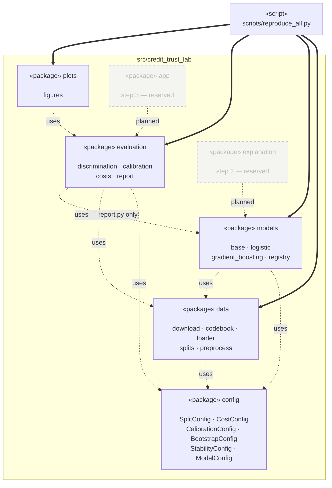
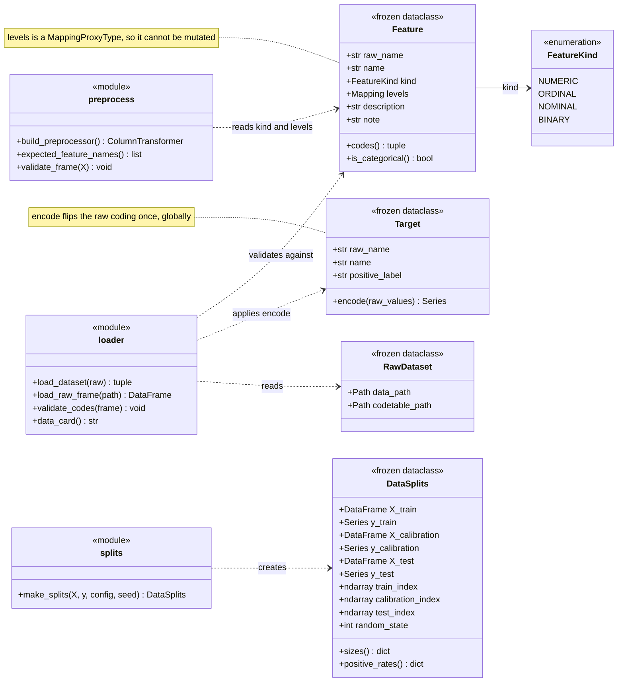
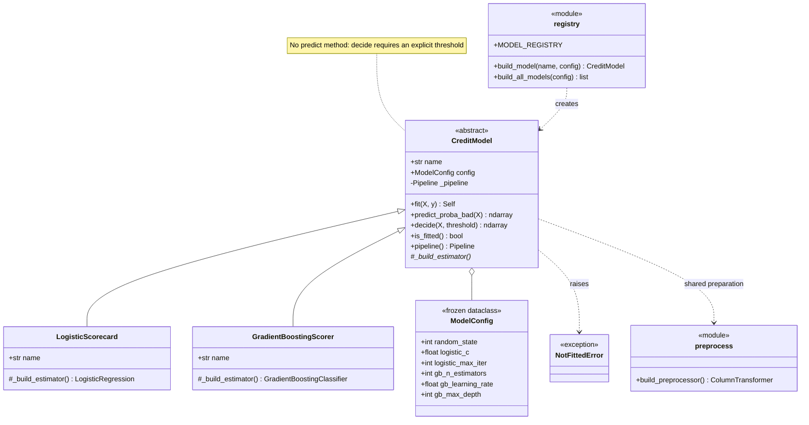
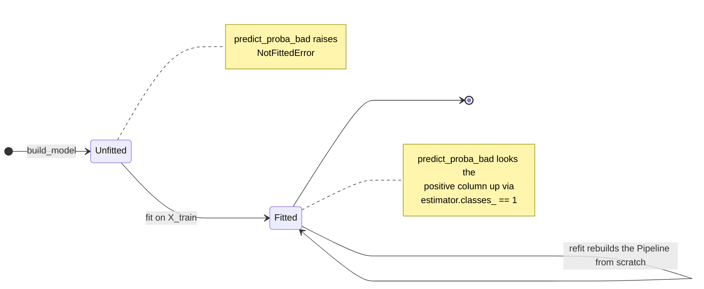
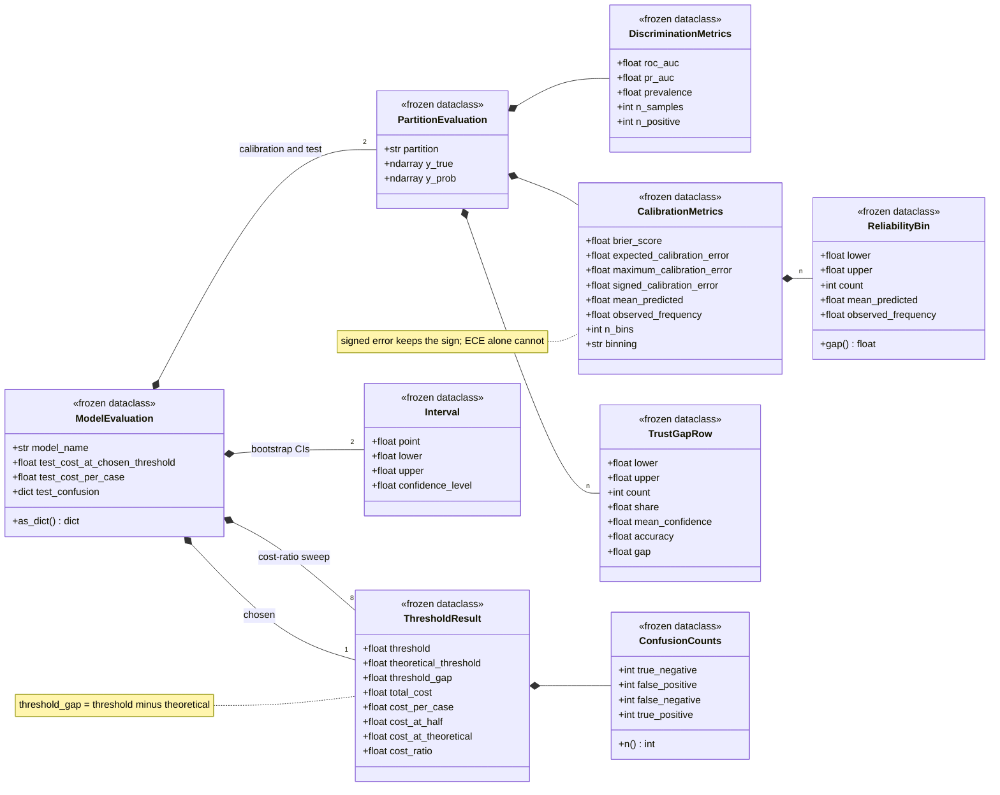
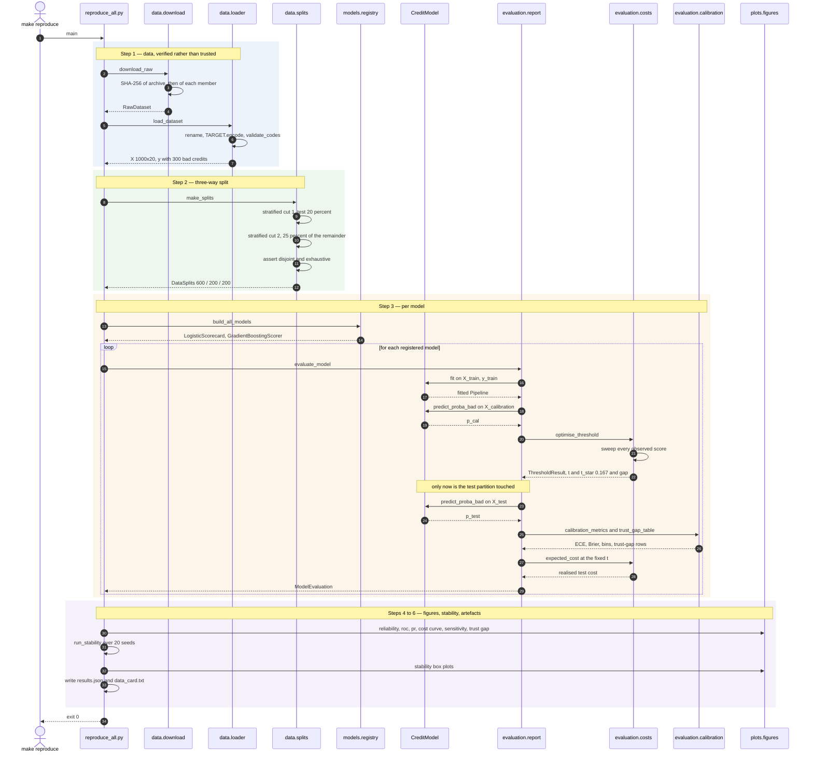
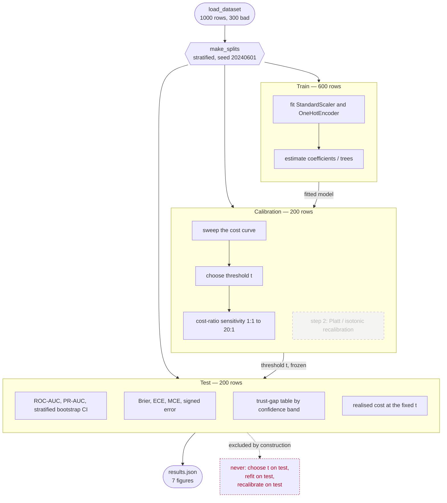

# Architecture

UML models of `credit-trust-lab`. Diagrams are Mermaid, so they render on
GitHub and stay diffable — a PNG that silently drifts away from the code is
worse than no diagram.

Six views, each answering a different question:

| # | Diagram | Question it answers |
| --- | --- | --- |
| 1 | Package diagram | How are the layers allowed to depend on each other? |
| 2 | Class diagram — data | What is the coding table, structurally? |
| 3 | Class + state — models | What contract do both models satisfy? |
| 4 | Class diagram — evaluation | What exactly is reported per model? |
| 5 | Sequence diagram | What happens during `make reproduce`? |
| 6 | Activity diagram | Which partition is allowed to touch what? |

---

## 1. Package diagram — the one-way dependency rule

The load-bearing architectural claim: dependencies point in exactly one
direction. `evaluation` cannot import `models` for metric computation, so it
has no way of treating two models differently. It only ever sees two arrays,
`y_true` and `y_prob`.

Two details the diagram makes visible:

- **Only `evaluation/report.py` depends on `models`** — it needs `CreditModel`
  to call `fit` and `predict_proba_bad`. The three metric modules
  (`discrimination`, `calibration`, `costs`) import nothing from `models` at
  all. That is what makes identical treatment structural rather than intended.
- **The reserved packages depend on stable interfaces only.** An explainer
  needs `CreditModel.predict_proba_bad`; the interface layer needs
  `ModelEvaluation`. Neither requires a change below it.

---

## 2. Class diagram — the coding table as a structure

The codebook is the project's contract with the raw file. `FeatureKind` is not
documentation: it is the switch that `preprocess.py` reads to decide between
scaling and one-hot encoding.

`Feature.note` carries the caveats that must survive into the report — for
example that level 1 of `savings` means *unknown or no account*, not a measured
balance. `loader.data_card()` renders those notes to
`reports/metrics/data_card.txt`, so they travel with the results.

---

## 3. Class and state diagram — the model contract

Both models are reduced to one operation: given a predictor frame, return
P(bad credit). Subclasses supply nothing but the estimator.

The lifecycle is two states, and the guard between them is enforced rather than
documented:

`fit()` constructs a **new** `Pipeline` on every call, so no state survives a
refit. That is what lets the 20-seed stability run reuse the builder without
risk of contamination.

---

## 4. Class diagram — what is reported per model

Every evaluation collapses into one serialisable record. Note that
`ThresholdResult` carries *both* thresholds: the empirical optimum and the one
perfect calibration would imply. Their difference is the project's headline
diagnostic, expressed in decision units.

---

## 5. Sequence diagram — one run of `make reproduce`

The runtime flow. The single most important thing it encodes: the threshold is
optimised on the **calibration** partition and only then applied to test.

---

## 6. Activity diagram — which partition may touch what

The rule the whole three-way split exists to enforce. Arrows only ever move
downward: no quantity fitted on a later partition flows back to an earlier one,
and nothing is fitted on test at all.

Each partition consumes only what an earlier one produced. The threshold `t` is
a fitted parameter like any coefficient; fitting it on the reporting data would
be the same leak as fitting a coefficient there, only harder to notice because
it looks like evaluation rather than training.

---

## Where the invariants are enforced

Diagrams describe intent; these tests make the intent binding.

| Modelled property | Enforced by |
| --- | --- |
| Partitions are pairwise disjoint and exhaustive | `splits._assert_disjoint_and_exhaustive()` at runtime, plus `tests/test_splits.py` |
| Threshold fitted on calibration, not test | `test_threshold_is_fitted_on_calibration_and_applied_to_test` |
| No `predict()` reinstating 0.5 | `test_decide_requires_an_explicit_threshold` |
| `predict_proba_bad` really returns P(bad) | `test_probabilities_are_oriented_towards_bad_credit` |
| Codebook matches the raw file | `loader.validate_codes()`, plus the integration tests in `tests/test_codebook.py` |
| Corrected data edition, not the legacy UCI one | `test_foreign_worker_minority_is_the_foreign_one` |
| Design matrix width independent of the split | `test_declared_categories_survive_absence_from_the_training_rows` |
| Threshold arithmetic | `test_optimal_threshold_matches_theory_on_calibrated_scores` |
